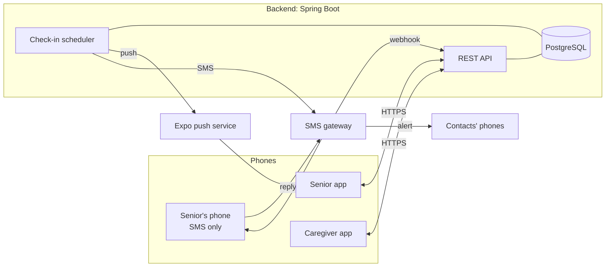
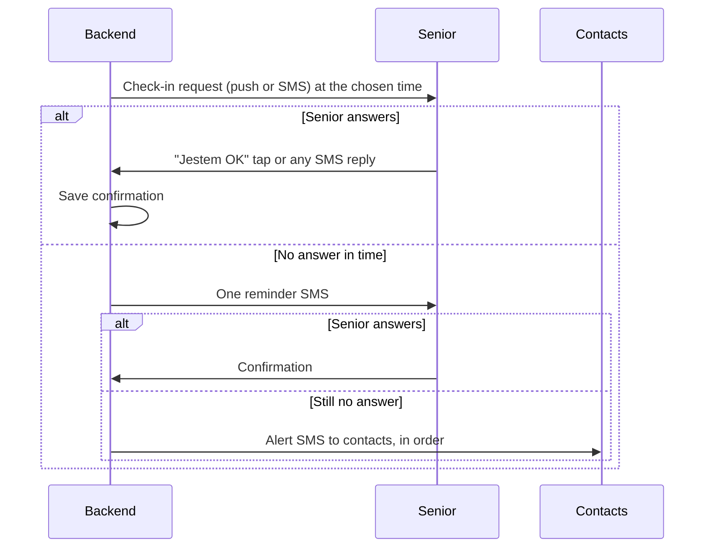

# Architecture

## Components

## The daily check-in

Every senior has a **channel**: `APP` (push notifications) or `SMS`. The logic is the same for both; only sending and receiving differ.

### Rules

- **Any SMS reply** from the senior's registered number counts as confirmation. Typos happen; a reply at all proves the senior is responsive.
- App users get the reminder as **SMS** too, because push notifications can silently fail (phone off, notifications disabled, battery saver).
- All times are in **Europe/Warsaw**.
- Exact times and delays are configurable. Defaults are decided in an issue.

## Registration

- A senior with a smartphone registers in the app and confirms the phone number with an SMS code.
- A caregiver can register a senior. The senior then gets an SMS and must reply to agree. **No consent, no monitoring.**
- No passwords. The phone number confirmed by SMS identifies the user.

## Sending messages

The backend never calls an SMS or push provider directly from business logic. It uses two interfaces:

- `SmsSender`, which sends and receives SMS;
- `PushSender`, which sends push notifications through Expo.

Each has a **fake** implementation that only writes to the log, used in development, tests and CI, so nobody spends money by accident. The real implementations are switched on by configuration in production.

## Reliability

A missed alarm is the worst possible failure. Therefore:

- the scheduler must not run twice for the same check-in, which is handled with ShedLock once more than one instance runs;
- every sent and received message is stored, so we can always answer "what happened to this senior yesterday?";
- production hosting must be **always on**. Free tiers that sleep when idle are fine only for development.

## Personal data (RODO)

We store phone numbers and names of seniors and their contacts, plus confirmation times. Nothing else:

- no location, no health data;
- contacts are told why they receive messages;
- data is deleted when a senior leaves the service.

## Planned, not in the December scope

- Integration with the Sopot city app *Karta Mieszkańca*. The API is kept clean so it can be added later.
